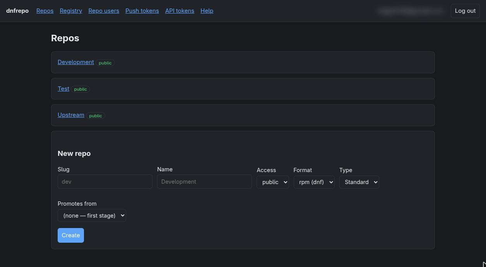
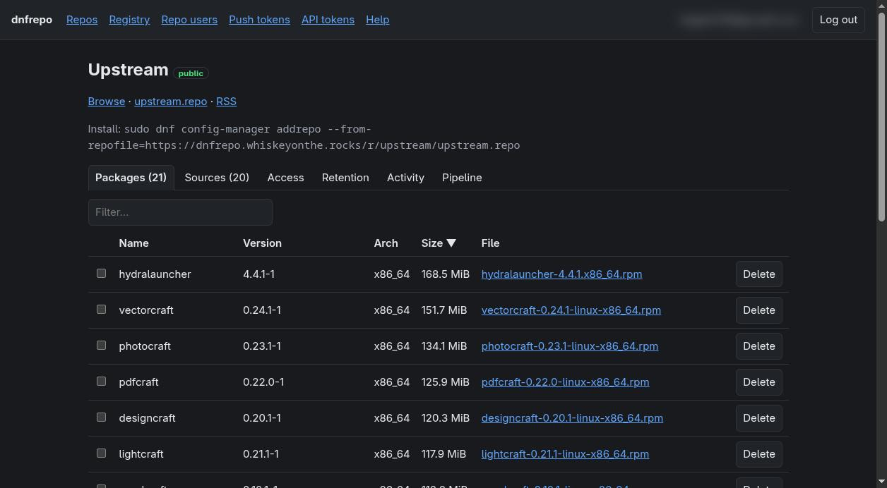
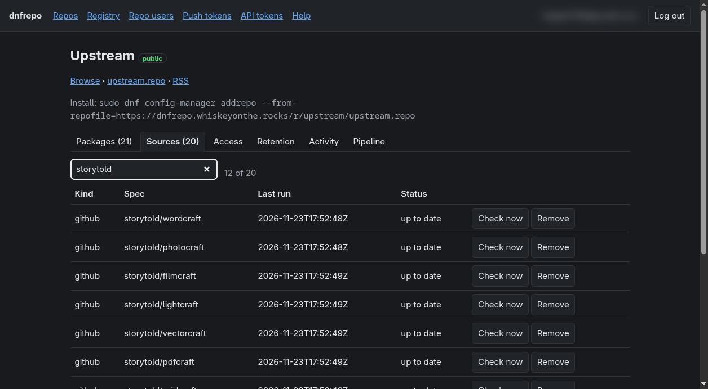
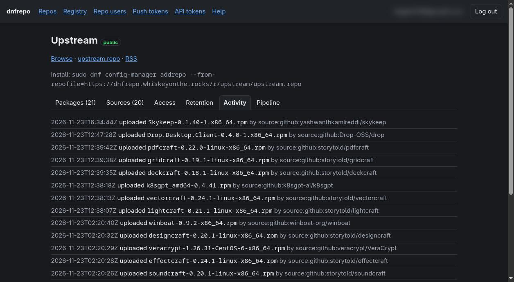
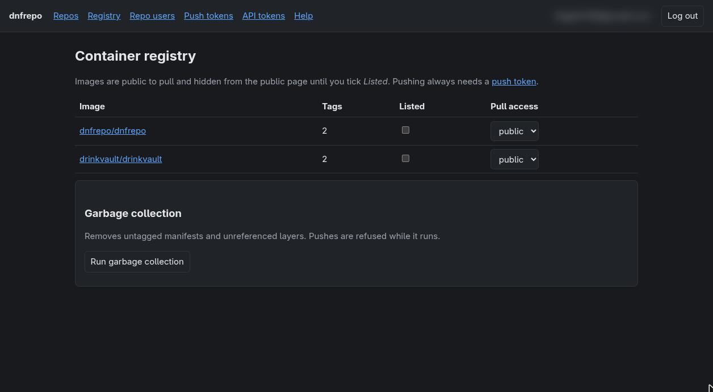

# dnfrepo

A self-hosted package server for a homelab or small team. One Go binary (plus PostgreSQL) serves:

- **signed dnf/yum (rpm) and apt (deb) repositories**, filled by upload, by GitHub release and Plex sources, or by mirroring an upstream repo, either fully synced or as a pull-through cache;
- **dev → test → prod pipelines**, where packages move between stages only by promotion;
- **a Docker/OCI container registry** with per-image pull access and token-only pushes;
- **a React admin UI** and a JSON API, with admins signing in through OpenID Connect (Authentik).

## Features

**Repos**

- Many repos, each served at `/r/<slug>/` with metadata signed by an instance GPG key: `createrepo_c` metadata for rpm (`repo_gpgcheck=1`), pure-Go `Packages`/`Release`/`InRelease` for deb.
- **Two formats:** a repo is `rpm` or `deb`, fixed at creation; a pipeline never mixes them. See "apt/deb repos" below.
- **Pipelines:** link repos in a chain. Only the first repo takes uploads, sources and mirrors; later repos get packages only by promoting from the previous one (one or many packages, or a whole sync batch, all-or-nothing).
- **Access, one mode per repo:** `public`, `ips` (IP/CIDR allowlist), or `users` (HTTP Basic auth with per-user tokens). It covers packages, metadata, the browse page, the feed and the `.repo` file.
- **Retention:** keep only the newest N versions of each package (default limit plus per-package overrides; 0 = unlimited), per name and arch, ordered with rpm or dpkg version rules. Enforced after every upload or promotion and when the limits are saved; each stage has its own limits.
- **Dedup:** identical packages (same sha256 and size) share one file through hardlinks. Promotion always links; `DEDUP=true` also links new uploads, syncs and sources, and `POST /api/dedup` merges duplicates already on disk. Needs one filesystem for all repos.
- Browse page, `<slug>.repo` file and RSS feed per repo, and an activity log of every upload, promotion, purge and sync.

**Getting packages in**

- **Upload** an `.rpm` or `.deb` in the UI or with the API (`curl` with an API token).
- **Sources** (first stage only): the latest GitHub release asset (`owner/name`, rpm or deb) and Plex Media Server. Checked when added, then every 24 h (first check a minute after startup), or on demand (*Check now*).
- **Mirrors:** copy an upstream dnf repo (base URL or a pasted `.repo` file) or a Debian/Ubuntu suite on a schedule, with arch and name filters, upstream signature checks and sealed credentials. Each sync is a batch you can promote as a unit. See "Mirror repos" below.
- **Cache mirrors (pull-through):** publish upstream's index but download a package only the first time a host asks for it, then keep the ones hosts pulled most recently. Saves disk and bandwidth when hosts use a small part of a big repo. See "Cache mode" below.

**Container registry** (optional, `REGISTRY_DIR`)

- The Distribution registry, embedded under `/v2/`: no sidecar.
- Pull access per image (`public` / `ips` / `users`, sharing the repo users), pushes only with push tokens, an opt-in public browse page (`/browse/registry`), tag deletion and garbage collection from the UI. See "Container registry" below.
- **Image mirrors:** follow an upstream tag such as `docker.io/plexinc/pms-docker:latest`, copying only when it changes, with selectable CPU types and the last N versions kept as dated tags.

**Admin**

- Sign-in through OpenID Connect, limited to one group; or a single local admin for a homelab. Admin API tokens for scripts.
- The UI shows each repo in tabs (packages, sources or mirror, batches, access, retention, activity, pipeline), with sortable, filterable, paginated package and source lists. The packages list shows when each package was added.
- Works on a phone: on narrow screens every table turns into one card per row, each value labelled with its column, and sortable columns become buttons above the cards.
- The login page explains what dnfrepo does, for people who land on it. After sign-in, the footer shows the running version and build.

## Screenshots

| | |
|---|---|
|  |  |
| Repos | Packages: sortable columns, filter, paging |
|  |  |
| Sources: GitHub and Plex, filtered | Activity |
|  | |
| Container registry | |

## Run

```
docker build --build-arg VERSION=$(git describe --tags --always) --build-arg BUILD=$(git rev-parse --short HEAD) -t dnfrepo .
docker run -d --name dnfrepo -p 8080:8080 -v dnfrepo-data:/data \
  -e DATABASE_URL=postgres://user:pass@db/dnfrepo \
  -e BASE_URL=https://repo.example.org \
  -e OIDC_ISSUER=https://auth.example.org/application/o/dnfrepo/ \
  -e OIDC_CLIENT_ID=... -e OIDC_CLIENT_SECRET=... \
  dnfrepo
```

`VERSION` and `BUILD` are optional; without them the UI footer and the startup log show `dev (build unknown)`. The GitHub and GitLab pipelines pass the branch and commit.

### Kubernetes (Helm)

`charts/dnfrepo` deploys the image from `ghcr.io/harnish/dnfrepo` (override `image.repository`/`image.tag`). Create the secrets first (`dnfrepo-secrets` with `DATABASE_URL`, `dnfrepo-oidc` with `OIDC_CLIENT_ID`/`OIDC_CLIENT_SECRET`; names and keys are values), then:

```
helm install dnfrepo charts/dnfrepo --set baseURL=https://repo.example.org \
  --set oidc.issuer=https://auth.example.org/application/o/dnfrepo/ --set ingress.enabled=true --set ingress.host=repo.example.org
```

One replica with a `Recreate` strategy, since `/data` cannot be shared. Data uses a PVC by default; set `persistence.existingClaim` or `persistence.hostPath` instead. Optional secrets (`adminEmail`/`adminPassword`, `secretKey`) are enabled by giving their `name`.

Admins sign in through OpenID Connect (built for Authentik). Only members of the `OIDC_ADMIN_GROUP` group can get in; the group is checked at login, so removing someone takes effect when their session expires (12 hours).

Authentik setup: create an OAuth2/OpenID Provider (confidential client) with redirect URI `<BASE_URL>/api/auth/oidc/callback` and scopes `openid email profile`, bind it to an Application, and create the admin group (default name `dnfrepo-admins`). The ID token must carry a `groups` claim; Authentik's default `profile` scope mapping provides it. The provider is contacted on first login, not at boot, so repo serving keeps working while Authentik is down (admin login returns 503 until it's back).

Admin sign-in limits to know about:

- **Removal is not instant.** Group membership is read only at login. Removing or disabling someone in Authentik does not end a session they already have; it lasts up to 12 hours. To cut access sooner, delete their rows: `DELETE FROM admin_sessions WHERE email = '<their email>';`.
- **Audit attribution uses the `email` claim.** Access is decided only by the `groups` claim, but the audit log records the email. An admin who can edit their own email in Authentik could appear in the log as another admin. Disable self-service email editing in Authentik (user settings stage) if attribution matters to you.

| Variable | Default | Meaning |
|---|---|---|
| `DATABASE_URL` | required | PostgreSQL DSN |
| `BASE_URL` | required | Public URL, used in `.repo` files and the OIDC redirect URI |
| `LISTEN_ADDR` | `:8080` | HTTP listen address |
| `DATA_DIR` | `/data` | rpms, metadata, and the GPG key (`gpg/signing-key.asc`, mode 0600) — back this up |
| `TRUSTED_PROXIES` | empty | Comma-separated IPs/CIDRs of reverse proxies whose `X-Forwarded-For` is trusted (needed for `ips` mode behind a proxy) |
| `ADMIN_EMAIL` `ADMIN_PASSWORD` | empty | Homelab bypass: set both and the login page shows an email/password form instead of Authentik; the `OIDC_*` vars then become optional. One shared admin, same 12 h session and per-IP throttle. Use a long random password and keep it in a Secret |
| `OIDC_ISSUER` | required (unless local admin set) | Issuer URL, e.g. `https://auth.example.org/application/o/<slug>/` |
| `OIDC_CLIENT_ID` `OIDC_CLIENT_SECRET` | required (unless local admin set) | From the Authentik provider |
| `OIDC_ADMIN_GROUP` | `dnfrepo-admins` | Group whose members are admins |
| `GITHUB_TOKEN` | empty | Avoids GitHub API rate limits for sources |
| `MAX_UPLOAD_BYTES` | 1 GiB | Per-rpm upload limit |
| `MIRROR_MAX_RPM_BYTES` | 4 GiB | Per-rpm limit for mirror downloads |
| `SECRET_KEY` | empty | Seals mirror upstream credentials (username/token) in the database. Needed only when a mirror uses credentials. If you remove or change it later, stored credentials can no longer be decrypted: clear them and enter them again |
| `REBUILD_TIMEOUT` | `10m` | Cap for one metadata rebuild (Go duration, e.g. `30m`); raise it for very large mirrors |
| `REGISTRY_DIR` | empty | Enables the container registry (Docker/OCI) and stores its data here (the standard registry layout, so an existing `registry` data directory can be reused). The directory must be writable by the dnfrepo user |
| `REGISTRY_HOST` | host of `BASE_URL` | Hostname shown in pull commands; set it when the registry has its own hostname |
| `DEDUP` | `false` | When `true`, a newly uploaded, mirrored or source-fetched rpm is hardlinked to an identical existing file (same sha256 and size) instead of stored again. Needs repos on one filesystem; otherwise it keeps a normal copy. Promotion always hardlinks. Existing duplicates: `POST /api/dedup` |

TLS is not handled by the app: put it behind a reverse proxy (and set `TRUSTED_PROXIES`). Use HTTPS for `users`-mode repos, since Basic auth sends the token on every request.

## Container registry

Set `REGISTRY_DIR` and dnfrepo serves a Docker/OCI registry under `/v2/` (the Distribution registry, embedded: one process, no sidecar). Point a hostname at dnfrepo (e.g. `registry.example.org`) and set `REGISTRY_HOST` to it.

- **Pull access is per image** (Registry page): `public`, `ips` or `users` (users are the same *Repo users* as for rpm/deb repos, granted per image). An image with no settings is public, so existing anonymous pulls keep working.
- **Listed** (off by default) puts a public image on the read-only browse page `/browse/registry` and in the anonymous catalog. Unlisted images can still be pulled by name if access allows; they are just not advertised.
- **Pushing is never anonymous.** Create a *Push token* (admin UI), then `docker login registry.example.org -u <token name>` with the token as the password. `docker login` does not verify the token (a repo user's token is only valid per image, so the server cannot judge it at login); a wrong token shows up as 401 on the first push. A push token may push and pull any image; a first push creates the image with the defaults (public, unlisted). Deleting over the registry HTTP API is refused; delete tags and run garbage collection from the admin UI.
- **Anonymous and unknown names look the same:** an anonymous request for an image that is private or does not exist gets the same 401, so names are not revealed. The catalog (`/v2/_catalog`) shows anonymous callers only Listed public images; a push token sees everything; a repo user also sees the images they are granted.
- **Garbage collection** (admin UI) removes untagged manifests and unreferenced layers. Pushes are refused with 503 while it runs and it waits up to 60 s for running uploads first (else it aborts and deletes nothing); pulls continue. A client that is between uploading its layers and pushing its manifest when GC starts can lose those layers (standard registry behaviour); it just retries the push.
- No body-size limit or write timeout applies to `/v2/`, so large layers upload fine; put a proxy in front only if you want limits.
- TLS comes from your reverse proxy, as with the rest of dnfrepo; set `TRUSTED_PROXIES` so `ips` mode sees client addresses. Moving an existing registry: [docs/registry-cutover.md](docs/registry-cutover.md).

### Image mirrors

Follow an upstream image tag, like a GitHub source follows releases. On the Registry page, *Add mirror* takes an upstream reference (`docker.io/plexinc/pms-docker:latest`; a bare `alpine` means `docker.io/library/alpine:latest`), the local name (default: the upstream path), the CPU types to copy and how many versions to keep (default 3).

- **Runs:** when added, a minute after startup and then every 24 h, or *Check now*. A run asks upstream for the tag's digest; unchanged (and the local tag still points at the last copy) means nothing is downloaded. A changed tag is downloaded into `<DATA_DIR>/image-staging`, each layer checked against its sha256, then imported. Pushes pause only for that local import, never for the download.
- **Tags:** each copy moves the local tag (same name as upstream's) and adds a dated tag `<tag>-YYYYMMDD` (`-2`, `-3` for more copies the same UTC day). Only the newest N dated tags this mirror created are kept; older ones are untagged and freed at the next garbage collection. Tags you pushed yourself are never pruned, but the mirror owns its moving tag: a push over it is replaced at the next run.
- **CPU types:** *Load platforms* lists what upstream publishes. None selected (or all) copies the image exactly, attestations included, so the digest matches upstream. A subset gets a new index without attestations. If a selected type disappears upstream, the run fails and the previous copy stays.
- **Credentials:** optional upstream username and token (needs `SECRET_KEY`; sealed, never shown again). A new image from a mirror with credentials starts in `users` mode with nobody granted, so a private image is not served until you open it. Without credentials it starts public and unlisted. Existing access settings are never changed.
- Docker Hub's token sign-in, ghcr.io and other v2 registries work. Not copied: Docker schema1 images, cosign signature tags, referrers. Removing a mirror keeps the local image.

Helm: `registry.enabled=true`, plus `registry.host` and `registry.hostPath` (or `existingClaim`). It adds the registry hostname to the Ingress.

## Mirror repos

A mirror is an empty first-stage repo that copies an upstream dnf repo. Give it a base URL, or paste a `.repo` file and pick a section. Variables such as `$releasever` and `$basearch` are resolved once, when you save; a metalink or mirrorlist is resolved to its first URL then. Only the first `gpgkey` URL of a `.repo` section is used. Fedora example: one mirror per release and repo (for example `fedora-42` and `updates-42`), synced on the schedule you test against.

- **Filters:** architectures, include/exclude globs on package name, and keep-latest N versions.
- **Schedule:** manual, daily, weekly or monthly, with a time and time zone. A schedule missed while the service was down runs once at startup. Sync now runs on demand.
- **Signature:** optionally verify upstream metadata with a GPG key. The mirror re-signs its own metadata with the instance key, so clients use this server's `/gpg.key`.
- **Credentials:** optional username and token for the upstream, stored sealed with `SECRET_KEY` and never returned by the API.
- **Batches:** every sync is a numbered batch. A batch can be promoted to the next stage as a unit, and again from each later stage it reaches.
- **First sync:** a sync publishes only when it is fully downloaded and verified, so a big repo shows nothing until the whole first sync finishes. A sync stops after 6 hours, so a very large first sync may take more than one run; files already staged and verified are reused, not downloaded again. If a sync published but its metadata rebuild failed, the next sync retries the rebuild even when nothing new is upstream. Syncs are additive: upstream deletions are not mirrored, and a package you delete by hand comes back at the next sync.
- **Disk:** the mirror's size and the staging directory (`<DATA_DIR>/mirror-staging`) are the operator's concern. Staging is not cleaned up automatically. Internal and private upstream URLs are allowed (admins are trusted).
- **Editing:** saving replaces every field except the credentials and the mode (both kept when omitted). Incremental `createrepo_c --update` exists but is off (no measured speedup). Frozen snapshot URLs are not supported yet (see `docs/TODO.md`).

### Cache mode (pull-through)

Set the mirror's mode to `cache` to store only what hosts actually download. The schedule (or "Refresh index") fetches upstream's index and verifies it as a sync would (signature, then every index file's sha256), but downloads no packages. rpm repos serve upstream's `repodata/` files as they are, with `repomd.xml` re-signed by this server; deb repos regenerate the signed archive from upstream's indexes. Hosts therefore see every upstream package.

- **First request:** a package not stored yet streams from upstream to the host while it is saved; it is kept only if its size, sha256 and header match the index. If the host disconnects, the download still finishes and is kept. A second host asking during that download is proxied from upstream directly. Upstream unreachable and not cached: `502`.
- **Retention:** the same limit as other repos (repo keep, per-name overrides, mirror `keep_latest`; the smallest positive wins), per name and arch, but ranked by `last_pulled` (updated on every download) instead of version. Purging removes only the local file; the package stays downloadable. A refresh also drops cached packages upstream no longer lists.
- **Limits:** include/exclude filters do not apply (rpm arches too; deb arches pick which indexes are published). The mode can only change while the repo has no packages. Metadata rebuilds do nothing for cache repos, so upstream's index is never replaced by the cached subset.

## apt/deb repos

Pick **deb (apt)** when creating a repo (API: `kind:"deb"`). A deb repo has one **suite** (default: the slug), one or more **components** (default `main`, fixed at creation) and **architectures** (default `amd64 arm64`, at least one real one). Packages of arch `all` appear in every arch's index. The kind cannot change, and a pipeline never mixes rpm and deb repos.

- **Own packages:** upload `.deb` files to a first-stage repo. The filename must be `<Package>_<version without epoch>_<Arch>.deb`; the control data inside the file is authoritative. GitHub release `.deb` assets work as sources; Plex is rpm-only.
- **Promotion:** a package can only be promoted into a deb stage that accepts its component and architecture (`all` always passes); otherwise the whole promotion is rejected with 409. Suite names may differ per stage.
- **Retention:** per (name, arch) with dpkg version ordering.
- **Mirrors:** a mirror of a Debian/Ubuntu suite takes the archive base URL, suite, components and architectures, and optionally an armored GPG key (with `require_signature`). It verifies `InRelease`, or `Release` plus `Release.gpg` (one valid signature from any key in the file suffices), and checks each index and package against the hashes in `Release`. Signed-by-this-server metadata replaces the upstream signatures, as for rpm mirrors.
- **Metadata:** `Packages`, `Packages.gz`, `Release`, `Release.gpg` and `InRelease` are generated in pure Go and swapped atomically (`dists.<gen>/` plus a symlink). `Release` has no `Valid-Until`. Changing a repo's architectures affects only future uploads, promotions and indexing.
- **Not supported:** `Sources`, `Contents`, `by-hash`, i18n translations, `.udeb`.

Client setup:

```
curl -fsS https://repo.example.org/gpg.key | sudo tee /etc/apt/keyrings/dnfrepo.asc
echo "deb [signed-by=/etc/apt/keyrings/dnfrepo.asc] https://repo.example.org/r/<slug>/ <suite> main" | sudo tee /etc/apt/sources.list.d/<slug>.list
sudo apt update
```

The repo's browse page shows the exact lines. `users`-mode repos need an `/etc/apt/auth.conf.d/` entry with the repo user and token.

## Client setup (rpm)

```
sudo dnf config-manager addrepo --from-repofile=https://repo.example.org/r/<slug>/<slug>.repo
```

`users`-mode `.repo` files contain `username=YOUR_USERNAME` / `password=YOUR_TOKEN` placeholders. The Repo users page can download one with a new user's credentials filled in.

## Development

```
podman run -d --rm -p 5433:5432 -e POSTGRES_PASSWORD=pw postgres:17-alpine
export DNFREPO_TEST_DSN=postgres://postgres:pw@localhost:5433/postgres
go test ./...                       # DB tests skip when the variable is unset
cd web && npm install && npm test && npm run build   # builds web/dist, embedded into the binary
```

Requires `createrepo_c` on `PATH` for the publish tests and for running the service outside the container.

## API

Scripts authenticate with an admin API token (`Authorization: Bearer dnfr_...`, created on the API tokens page). Full reference for upload, delete and promote, with examples and error codes: [docs/api.md](docs/api.md). The admin UI uses the session cookie instead, and its state-changing requests need the header `X-Requested-With: dnfrepo`. Public routes: `GET /api/auth/methods`, `GET /api/auth/oidc/login` and `/callback`, `POST /api/auth/local`.

| | |
|---|---|
| `GET /api/auth/oidc/login` `callback`; `POST /api/auth/local`; `GET /api/auth/me`; `POST /api/auth/logout` | admin sign-in (OIDC, or local when `ADMIN_EMAIL`/`ADMIN_PASSWORD` set) |
| `GET/POST /api/auth/tokens`, `DELETE /api/auth/tokens/{id}` | admin API tokens (browser session only) |
| `GET/POST /api/repos`, `GET/PATCH/DELETE /api/repos/{slug}`, `PUT .../ips`, `PUT .../previous`, `GET/PUT .../users` | repos, pipeline links, access |
| `GET/POST /api/repos/{slug}/packages` (multipart `file`), `DELETE .../packages/{filename}` | packages |
| `POST /api/repos/{slug}/promote` `{"filenames":["foo-1.rpm","bar-2.rpm"]}` or `{"batch":12}` | promote to the next stage |
| `POST /api/mirror/parse-repo`, `GET/PUT/DELETE /api/repos/{slug}/mirror`, `POST .../mirror/sync`, `GET .../batches` | mirror repos (see docs/api.md) |
| `GET/POST /api/repos/{slug}/sources`, `DELETE /api/sources/{id}`, `POST /api/sources/{id}/run` | sources |
| `GET/POST /api/repo-users`, `DELETE /api/repo-users/{id}` | repo users and tokens |
| `PUT /api/repos/{slug}/keep` `{"keep":3,"overrides":{"plexmediaserver":10}}` | set retention limits and purge now (returns the purged filenames) |
| `POST /api/dedup` | hardlink identical rpms across all repos (returns `linked`, `bytes_saved`, `skipped`) |
| `GET /api/repos/{slug}/audit` | activity log (newest 100) |
| `GET /api/registry/repos`; `GET/PUT/DELETE /api/registry/repo?name=`; `DELETE /api/registry/tag?name=&tag=` | registry images: list, access settings, delete image or tag |
| `GET/POST /api/registry/gc` | registry garbage collection status / run |
| `GET/POST /api/registry/push-tokens`, `DELETE .../push-tokens/{id}` | registry push tokens |
| `GET /api/public/registry/repos`, `GET /api/public/registry/repo?name=` | public, read-only list of Listed images (no auth) |
| `GET/POST /api/registry/mirrors`, `PUT/DELETE .../mirrors/{id}`, `POST .../mirrors/{id}/run`, `POST .../mirrors/inspect` | registry image mirrors (see docs/api.md) |
| `GET /api/version` | running version and build, e.g. `{"version":"v1.4.0 (build 27ac652)"}` |
| `GET /gpg.key`, `GET /healthz` | instance signing key; health check |
